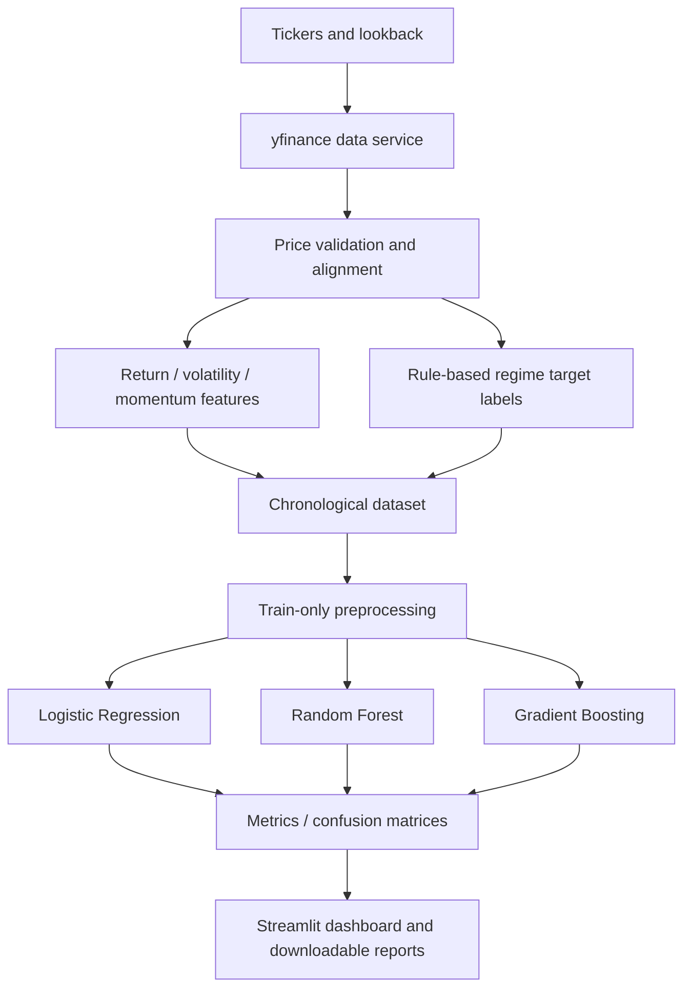

# Financial Risk Prediction & Market Regime Detection

A time-series machine-learning application that retrieves historical market prices, engineers return/momentum/volatility features, creates reproducible rule-defined regime targets, and compares Logistic Regression, Random Forest, and Gradient Boosting using a chronological holdout.

## Problem statement

Market risk changes over time. This project demonstrates how financial time-series features can be used to classify risk and market-regime conditions, while respecting temporal ordering during model evaluation.

## Features

- Historical adjusted prices via Yahoo Finance (`yfinance`).
- Return, rolling volatility, momentum, and drawdown features.
- Rule-derived HIGH_RISK, BULLISH, BEARISH, and SIDEWAYS target labels.
- Logistic Regression, Random Forest, and Gradient Boosting classifiers.
- Chronological train/test split (no random shuffle).
- Train-only preprocessing pipelines and class imbalance handling.
- Accuracy, weighted precision, recall, F1, and confusion matrices.
- Feature importance, Streamlit dashboard, JSON report, and CSV holdout predictions.

## Industry relevance

Useful as a learning/research prototype for quantitative research, market-risk analytics, portfolio monitoring, and FinTech data products. It is not a production risk engine.

## Technology stack

Python, Pandas, NumPy, scikit-learn, yfinance, Streamlit, Plotly, pytest.

## Architecture



## Folder structure

```text
03_Financial_Risk_Prediction_Market_Regime_Detection/
├── app.py
├── requirements.txt
├── README.md
├── LICENSE
├── CONTRIBUTING.md
├── .env.example
├── .gitignore
├── src/market_regime/
│   ├── data.py
│   ├── features.py
│   └── modeling.py
├── tests/
├── docs/
├── data/sample/
├── notebooks/
├── reports/
└── assets/
```

## Methodology and mathematical foundations

For adjusted price \(P_t\), simple return is \(r_t=P_t/P_{t-1}-1\). Rolling annualized volatility is:

\[
\sigma_t = \mathrm{Std}(r_{t-w+1},\ldots,r_t)\sqrt{252}
\]

Momentum over \(w\) sessions is \(P_t/P_{t-w}-1\). Drawdown is \(P_t/\max_{s\leq t}P_s-1\).

The regime target is a transparent heuristic:
- `HIGH_RISK`: forward realized volatility exceeds an expanding historical 70th-percentile threshold.
- Otherwise `BULLISH` if trailing momentum is above +3%.
- Otherwise `BEARISH` if trailing momentum is below -3%.
- Otherwise `SIDEWAYS`.

This target is a constructed proxy, not an objective market-regime ground truth. The forward volatility window defines the target outcome. Features at a date use observations available through that date. The expanding volatility threshold uses only historical observations at or before that date.

## Model evaluation

Rows are kept in chronological order. The earliest 75% (configurable) is training data and the latest portion is held out. Imputation/scaling are inside scikit-learn pipelines, so they are fit only on training data. Weighted precision, recall and F1 supplement accuracy. Class weights or balanced sample weights address class imbalance.

The holdout evaluates classification of the rule-derived labels; it is not a forecast of stock prices or a guaranteed future regime prediction.

## Data source

Historical adjusted prices are retrieved at runtime from Yahoo Finance via `yfinance`. No API key is required. Provider coverage, availability, rate limits, and terms can change. The dashboard does not fabricate prices.

## Installation

Python 3.10+ recommended.

```bash
python -m venv .venv
# Windows
.venv\Scripts\activate
# macOS/Linux
source .venv/bin/activate
pip install -r requirements.txt
```

## Run

```bash
streamlit run app.py
```

Enter one or more tickers (examples: `SPY, QQQ, IWM`), choose lookback and feature windows, then click **Fetch data & train models**. Internet access is required for live data.

## Dashboard

- Regime overview: class distribution and historical regime timeline.
- Model comparison: holdout metrics and confusion matrix.
- Feature importance: strongest model signals.
- Historical data: prices, engineered features, and labels.
- Exports: JSON evaluation report and CSV holdout predictions.

## Testing

```bash
pytest -q
```

Tests cover feature construction, label classes, chronological ordering, model evaluation, and minimum dataset validation.

## Limitations

- Regime labels are heuristic proxy targets and depend on thresholds/window settings.
- Expanding volatility thresholds and rolling windows are sample-dependent.
- Market behavior is non-stationary; model performance may degrade.
- A single chronological holdout is not a full walk-forward study.
- The gradient-boosting model is scikit-learn HistGradientBoosting (not XGBoost) to keep dependencies manageable.
- No transaction costs, portfolio constraints, options, macroeconomic variables, or live trading are modeled.

## Future improvements

Add nested walk-forward validation, probability calibration, XGBoost comparison, regime transition analysis, macro features, volatility clustering models, and portfolio-level stress testing.

## Resume-ready description

**Financial Risk Prediction & Market Regime Detection | Python, Pandas, Scikit-learn, Streamlit**
Developed a time-series ML application that engineers financial return, momentum, volatility and drawdown features; constructs reproducible market-regime labels; and compares Logistic Regression, Random Forest and Gradient Boosting using chronological holdout evaluation, confusion matrices and feature-importance analysis.

## Disclaimer

For education and research only. Not financial advice, a price prediction service, or a production risk-management system.
